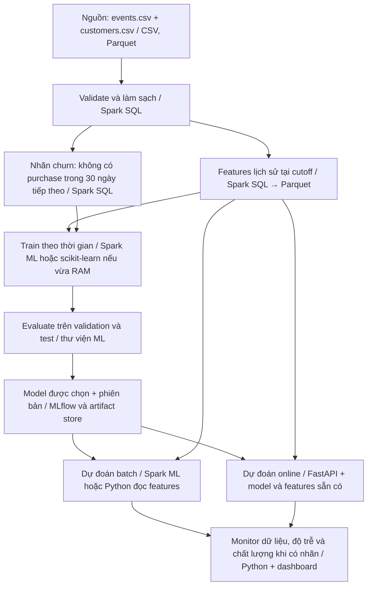

# Nhật ký ngày 01 — Bài mẫu tham khảo

[Đề bài](thuc_hanh.md) · [Code](bai_lam.py)

Đây là lời giải mẫu để đọc và chạy lại. Người học tự giải thích lại trước khi đánh dấu hoàn thành trong TIEN_DO.md.

## Thông tin lần chạy mẫu

- Ngày chạy: 26/10/2026.
- Python: 3.14.6, macOS arm64; chỉ dùng thư viện chuẩn, không cần Java.
- Interpreter: `/opt/homebrew/opt/python@3.14/bin/python3.14`.
- Ngày 01 chạy được bằng Python hiện có; các ngày Spark theo môi trường Python 3.11 trong hướng dẫn cài đặt của repo.
- Nguồn: CSV giả lập trong `data/raw/`; hash đã đối chiếu với `data/raw/manifest.json` bằng bộ kiểm tra repo.
- Trạng thái: đã chạy bài mẫu; chưa xác nhận người học đã tự thực hành hay giải thích lại.

## Tôi hiểu bài này như sau

Spark là bộ máy xử lý dữ liệu, còn CSV, Parquet hoặc database là nơi lưu dữ liệu. PySpark cho phép mô tả phép tính bằng Python để Spark thực hiện. Với CSV 20 MB vừa RAM, pandas thường đủ cho phép tổng hợp đơn giản. Với giao dịch nhiều năm vượt RAM một máy, Spark có thể chia việc trên nhiều máy; chạy local nhiều luồng vẫn chỉ dùng một máy. Trong bài toán churn, pipeline dữ liệu tạo feature lịch sử, pipeline ML huấn luyện và dự đoán, còn MLOps quản lý phiên bản, phát hành và giám sát.

## 1. Ý nghĩa từng dòng của hai bảng

- `events.csv`: một dòng là một sự kiện mua hàng, có khóa `event_id` và liên kết khách hàng bằng `customer_id`. Một khách hàng có thể có nhiều sự kiện. Ví dụ dòng đầu: E000001 của C002 xảy ra lúc 10:00 UTC ngày 01/01/2025, được nguồn ghi nhận lúc 11:00 UTC, số tiền 90.000 VND, loại `purchase`.
- `customers.csv`: một dòng là một khách hàng, khóa `customer_id` duy nhất. Ví dụ C001 ở HCM, gói basic, tham gia ngày 01/12/2024. Bảng này giữ cả khách hàng không có giao dịch để pipeline không bỏ mất họ khi tạo feature.
- `event_time` là lúc giao dịch xảy ra; `ingested_at` là lúc nguồn ghi nhận bản ghi. Phải xét cả hai khi tạo feature tại một cutoff để tránh dùng dữ liệu chưa sẵn có.
- `csv.DictReader` đọc giá trị thành chuỗi: `'90000'` chưa phải số nguyên. Ngày 01 chỉ đọc và mô tả; bước parse/validate sẽ làm ở các ngày sau.

## 2. Chọn công cụ cho ba tình huống

Các giả định dưới đây dùng để giải thích lựa chọn; tài nguyên và độ trễ chưa được benchmark.

1. CSV 20 MB: chọn pandas để khám phá và tổng hợp đơn giản.
   Giả định máy có RAM 8 GB, còn trống 4 GB; cần kết quả trong vài giây.
   Đo bộ nhớ và thời gian thực tế vì dữ liệu khi đọc có thể lớn hơn file CSV.
2. Giao dịch nhiều năm: chọn Spark SQL cho tổng hợp theo khách hàng.
   Giả định dữ liệu 2 TB trên Parquet, máy cá nhân có RAM 16 GB;
   có cluster 4 worker, mỗi worker 16 GB RAM, chạy batch mỗi đêm.
   Mục tiêu hoàn tất trong 2 giờ; cần benchmark để xác nhận tài nguyên đủ.
   Nếu dữ liệu đã ở kho SQL và truy vấn đạt mục tiêu, ưu tiên SQL sẵn có.
3. Sự kiện ứng dụng tới liên tục: Kafka nhận sự kiện, Spark Structured
   Streaming xử lý micro-batch và ghi Parquet/bảng kết quả.
   Giả định 10.000 sự kiện/giây, khoảng 1 KB/sự kiện, giữ Kafka 24 giờ;
   cluster khởi điểm 4 worker x 16 GB RAM, chấp nhận độ trễ 30–60 giây.
   Cần đo backlog, state và độ trễ; xử lý thời gian sự kiện và dữ liệu đến muộn.
   Các con số là giả định để chọn công cụ, chưa phải kết quả benchmark.

## 3. Sơ đồ pipeline churn

Đây là thiết kế cho các ngày tiếp theo; script ngày 01 chỉ xuất sơ đồ ra file.



- Feature dùng sự kiện trong `[cutoff − 30 ngày, cutoff)` và `ingested_at < cutoff`.
- Nhãn churn bằng 1 nếu không có purchase hợp lệ trong `[cutoff, cutoff + 30 ngày)`; chỉ tạo nhãn khi nguồn đã quan sát đủ cửa sổ tương lai.
- Dữ liệu train, validation và test chia theo các mốc thời gian của repo. Chọn cấu hình bằng validation; giữ test cho đánh giá cuối.
- Hai hướng huấn luyện là dùng Spark ML trực tiếp, hoặc chuyển bảng feature đã thu gọn sang scikit-learn nếu bảng đó vừa RAM.
- Batch ghi dự đoán định kỳ cho nhiều khách hàng; online trả kết quả khi có yêu cầu qua FastAPI. Online phải dùng feature đúng phiên bản, sẵn có tại thời điểm dự đoán.
- MLflow ghi thí nghiệm, tham số, metric và tham chiếu artifact; model được lưu trong artifact store. Model dùng để phục vụ phải khớp thư viện đã huấn luyện và cách tạo feature.

## 4. Vì sao học bằng dữ liệu nhỏ? (7 câu)

Repo dùng dữ liệu nhỏ để người học chạy được trên máy cá nhân.
Thời gian chạy ngắn giúp thử, quan sát lỗi và sửa nhanh hơn.
Với fixture nhỏ, ta có thể tính tay kết quả để đối chiếu phép lọc, join và tổng hợp.
Các nguyên lý như schema, partition, lazy evaluation và shuffle vẫn có thể minh họa bằng dữ liệu nhỏ.
Tuy nhiên, Spark local nhiều luồng chưa chứng minh chương trình chạy trên nhiều máy.
Dữ liệu nhỏ cũng chưa thể hiện đầy đủ chi phí truyền mạng, lệch phân vùng hay thiếu bộ nhớ ở quy mô lớn.
Sau khi hiểu đúng logic, ta cần đo trên dữ liệu và môi trường lớn hơn trước khi kết luận về hiệu năng.

## Lệnh chạy và kết quả thật

Chạy từ thư mục gốc repo:

```bash
python3 scripts/run_day.py 01
python3 scripts/check_repo.py
```

| Đầu vào | Số dòng kỳ vọng | Số dòng thực tế | Kích thước thực tế |
| --- | ---: | ---: | ---: |
| `events.csv` | 6.529 | 6.529 | 467.198 byte |
| `customers.csv` | 120 | 120 | 3.117 byte |
| `events_tiny.csv` | 4 | 4 | 338 byte |

Số dòng không tính header. Kết quả khớp tài liệu dữ liệu; bộ kiểm tra repo cũng báo OK cho hash, số dòng, khóa và các hợp đồng fixture. Bộ kiểm tra cấu trúc không chứng nhận người học đã hiểu bài.

Đầu ra tự tạo:

- Báo cáo và dòng dữ liệu mẫu: `artifacts/day-01/bao_cao.txt`.
- Sơ đồ Mermaid: `artifacts/day-01/pipeline.mmd`.
- Hai file được tái tạo khi chạy lại; script không sửa CSV nguồn.

## Biến thể đã thử

Đọc thêm `events_tiny.csv` bằng cùng hàm `describe_csv` thay cho bảng events đầy đủ. Kết quả là 4 dòng thay vì 6.529; header không bị tính thành một sự kiện. Dòng đầu là T001, khách hàng C001, số tiền dưới dạng chuỗi `'100000'`. Bằng chứng nằm ở mục 5 của báo cáo; đây là biến thể đọc dữ liệu nhỏ, chưa thực hiện tính feature hoặc train trên tiny.

## Trả lời câu hỏi tự kiểm tra

1. **Vì sao không đưa toàn bộ bảng Spark về pandas?** `toPandas()` gom dữ liệu vào bộ nhớ driver. Nếu bảng quá lớn, driver có thể hết RAM và mất lợi ích xử lý phân tán. Chỉ chuyển phần dữ liệu đã lọc hoặc tổng hợp, sau khi đánh giá bộ nhớ cần dùng.
2. **Batch khác streaming ở điểm nào?** Batch xử lý tập dữ liệu hữu hạn, ví dụ giao dịch hôm qua. Streaming xử lý nguồn dữ liệu mới tới liên tục, ví dụ sự kiện ứng dụng; cần theo dõi tiến độ xử lý và quản lý dữ liệu đến muộn. Spark Structured Streaming có thể xử lý theo micro-batch.
3. **MLflow lưu thí nghiệm còn Spark làm gì?** Spark đọc, biến đổi, join và tổng hợp dữ liệu; Spark ML còn có thể huấn luyện và dự đoán. MLflow ghi tham số, metric, phiên bản và artifact để đối chiếu các lần chạy và biết model nào được sử dụng.

## Bài mở rộng

`1.000.000 × 200 byte = 200.000.000 byte = 200 MB`, xấp xỉ 190,7 MiB. Đây là ước lượng kích thước dữ liệu theo đề, chưa phải RAM cần dùng. Khi xử lý còn có chuỗi/object, index, bảng hash, buffer và các bản sao trung gian; cần đo thực tế thay vì áp một hệ số cố định.

## Giới hạn và điều chưa làm

- Đã chạy thật: đọc/đếm CSV, in dòng mẫu và đường dẫn hai bảng, xuất báo cáo và sơ đồ, kiểm tra bộ repo.
- Đã thiết kế: ba lựa chọn công cụ và luồng từ dữ liệu đến hai cách dự đoán, có chỗ lưu model.
- Chưa triển khai: pandas, Spark, Kafka, tạo feature/nhãn, train/evaluate, MLflow, API và monitor.
- Chưa đo: hiệu năng, RAM khi xử lý và độ trễ trên dữ liệu lớn hoặc cluster.
- Bài mở rộng đã tính kích thước lý thuyết; chưa tạo tập một triệu dòng để đo.

## Chốt buổi học

- [x] Bài mẫu đã đối chiếu đầu ra với dữ liệu và yêu cầu day-01.
- [ ] Người học tự chạy biến thể, giải thích lại và cập nhật TIEN_DO.md.
